# Vibe-a-Gochi

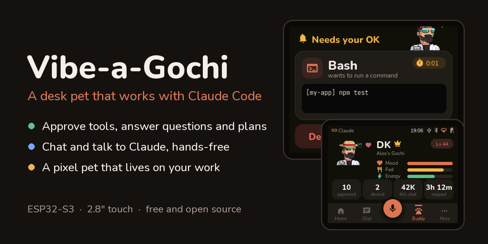

[](LICENSE)
[](../../releases/latest)
[](#what-you-need)
[](firmware/platformio.ini)

**A desk pet that works with Claude Code.** It lives on a 2.8" ESP32-S3 touch screen, shows what Claude
is doing, and lets you approve tools, answer Claude's questions and plans, stop it, chat and talk to
it, without touching the PC.

<p>
  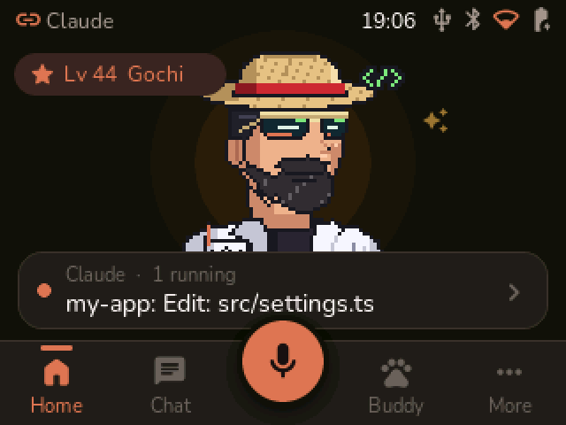
  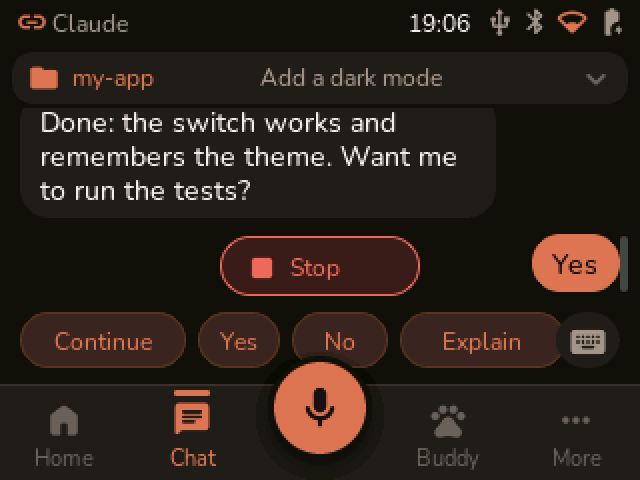
  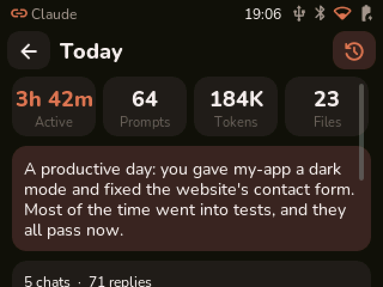
</p>

It's built for "vibe coding": you ask Claude Code for something, and while it works you can look away
from the computer. When Claude needs you, the board chimes. You can then:

- **approve or deny** a tool Claude wants to run (edit a file, run a command),
- **answer Claude's questions** and **approve its plans**, right on the screen,
- **stop** it, send quick commands ("Continue", "Run tests", "Commit"), or type a message,
- **talk to it**: the board has a microphone and a speaker, and can read replies aloud,
- see **the day's summary**: how long you worked, what changed, how much of your usage window is left.

And the pet itself: it eats your Claude activity, grows in level, gets tired, naps when you're away and
celebrates when work is done. It's a little Tamagotchi for your coding sessions.

Everything runs on your own board and PC. Speech is recognised and spoken locally with free,
open-source models, and no account or cloud service is needed besides Claude itself.

> Vibe-a-Gochi is an independent maker project, not made or endorsed by Anthropic. "Claude" is a
> trademark of Anthropic, PBC.

## Contents

1. [What you need](#what-you-need)
2. [How it works](#how-it-works)
3. [Flash the firmware](#1-flash-the-firmware)
4. [Connect the board to your WiFi](#2-connect-the-board-to-your-wifi)
5. [Set up your PC](#3-set-up-your-pc)
6. [Use it with Claude Code](#4-use-it-with-claude-code)
7. [Projects, chats and quick commands](#5-projects-chats-and-quick-commands)
8. [Talk to it](#6-talk-to-it)
9. [Your pet and your day](#7-your-pet-and-your-day)
10. [Portrait or landscape](#8-portrait-or-landscape)
11. [Optional: the Claude desktop app's Hardware Buddy](#9-optional-the-claude-desktop-apps-hardware-buddy)
12. [Updates and changing it](#10-updates-and-changing-it)
13. [What's in this repository](#whats-in-this-repository)
14. [Privacy](#privacy)
15. [Credits and licenses](#credits-and-licenses)

## What you need

**Hardware**

- **Hosyond ES3C28P**: the 2.8" ESP32-S3 touch display board (320×240 IPS, capacitive touch, 16 MB
  flash, 8 MB PSRAM, built-in microphone and speaker amplifier). Make sure you get the **ESP32-S3**
  version with capacitive touch. The older ESP32 "Cheap Yellow Display" boards will not work.
- A small speaker (8 Ω, 1–2 W) with the board's 2-pin speaker plug, if yours did not come with one.
- A USB-C data cable (not a charge-only one).
- Optional: a case or stand.

No soldering is needed.

**Software (all free)**

- A Windows PC with **Python 3.11 or newer** ([python.org](https://www.python.org/downloads/); tick
  "Add to PATH" when installing).
- **Claude Code**: in a terminal, an IDE, or the Code tab of the Claude desktop app. This is what the
  board watches and controls.
- To flash the board: Chrome or Edge, *or* [PlatformIO](https://platformio.org/) to build the firmware yourself.
- Optional: the **Claude desktop app**, for its Bluetooth "Hardware Buddy" link.

## How it works

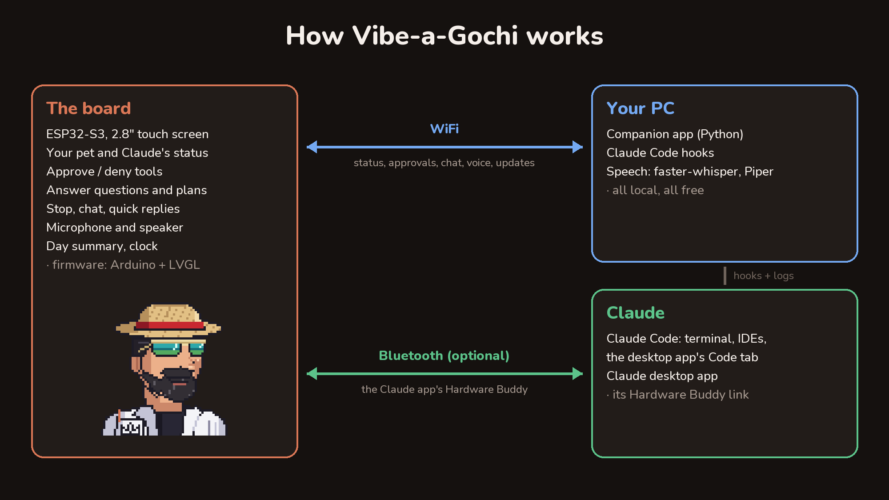

- **The board** runs the Vibe-a-Gochi firmware: the pet, the touch screens, sounds, microphone and speaker.
- **Your PC** runs a small Python **companion app**, and Claude Code **hooks** that tell the board what
  Claude is doing and wait for your answer when Claude asks for permission. The companion also turns
  your voice into text (faster-whisper) and replies into speech (Piper), both on your PC.
- **Claude**: Claude Code does the work; the board just talks to it.

The board and the PC talk over your **WiFi**, through a paired, token-protected connection. Optionally,
the board can also connect over **Bluetooth** to the Claude desktop app's "Hardware Buddy" feature,
which Anthropic published as an open protocol.

## 1. Flash the firmware

You only need the USB cable once. After that, updates go over WiFi.

**Put the board in download mode:** plug it into your PC, hold the **BOOT** button, tap **RST**, then
let go of BOOT. The screen stays dark; that's expected.

**Option A, no install (easiest):** download `vibe-a-gochi-factory.bin` and
`vibe-a-gochi-characters.bin` from the [latest release](../../releases/latest). In Chrome or Edge,
open Espressif's web flasher at [espressif.github.io/esptool-js](https://espressif.github.io/esptool-js/),
click **Connect** and pick the board's port. Then add both files with these addresses:

| Flash address | File |
|---|---|
| `0x0` | `vibe-a-gochi-factory.bin` (the firmware) |
| `0xc90000` | `vibe-a-gochi-characters.bin` (the DevelopKing character) |

Click **Program** and wait for it to finish, then press **RST**.

Or with esptool, if you have Python:

```
pip install esptool
python -m esptool --chip esp32s3 write_flash 0x0 vibe-a-gochi-factory.bin 0xc90000 vibe-a-gochi-characters.bin
```

**Option B, build it yourself:** clone this repository, install PlatformIO, and run in the `firmware`
folder (download mode before each command):

```
pip install platformio
pio run -t upload
pio run -t uploadfs
```

Press **RST**. The board starts, plays a chime, and the pet appears.

## 2. Connect the board to your WiFi

On the board, tap **More** (bottom right), then **Settings**, then **WiFi**. Pick your network and type
its password on the on-screen keyboard. The board remembers it.

The board needs a 2.4 GHz network (the ESP32-S3 has no 5 GHz radio). The PC and the board must be on
the same network.

While you're in Settings, set **Owner** to your name and give your pet a **Pet name**. Its page then
says "Alex's Rex", or whatever you choose.

<p>
  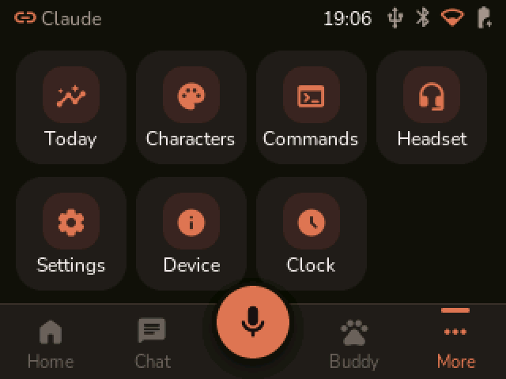
  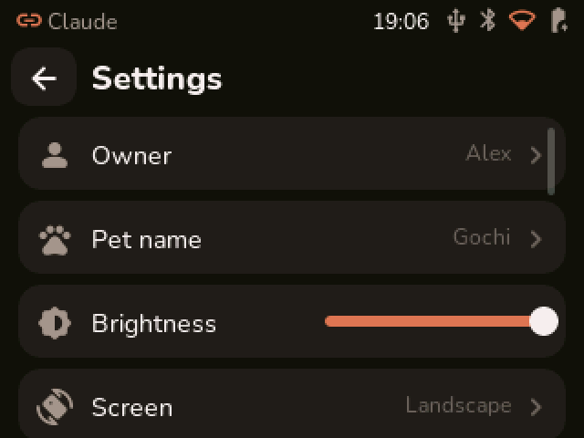
</p>

## 3. Set up your PC

Clone or download this repository somewhere you'll keep it, for example in your Documents folder.
Then double-click **`Setup Vibe-a-Gochi.bat`**. It:

1. installs the Python packages it needs,
2. **pairs** with the board: the board shows a 6-digit code, type it in the setup window,
3. adds the Claude Code **hooks** to your Claude Code settings (a backup of your settings is kept),
4. registers the board as an **MCP server**, so Claude can also ask you questions or show you a note on
   the board by itself,
5. and starts the companion app, now and whenever Windows starts.

**Voice:** to talk to the board and hear replies, run the setup with speech. In a terminal in the
repository folder, run:

```
"Setup Vibe-a-Gochi.bat" --voice
```

The first time you talk, it downloads the speech models (about 500 MB).

Every step is safe to repeat. To remove the hooks again, run the setup with `--uninstall`.

## 4. Use it with Claude Code

Open Claude Code in any project and ask for something. The home screen shows what Claude is doing: the
project, the tool it's running, and the pet's mood.

- **Approvals:** when Claude wants to run a tool that needs your permission, the board chimes and shows
  it. Tap **Approve**, **Always** or **Deny**, or answer on the PC as usual: whichever answers first wins.
- **Questions:** when Claude asks you something, the question and its options appear on the board.
  Pick one or more options, or tap **Type an answer** to write your own.
- **Plans:** in plan mode, the board shows Claude's plan. Scroll through it, then approve it or tell
  Claude to keep planning.
- **Stop:** the Stop button in Chat, or in Quick commands, stops Claude after its current step.

<p>
  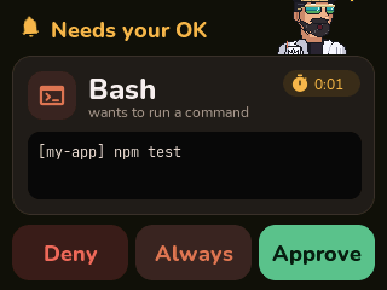
  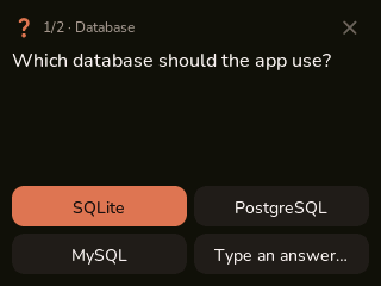
  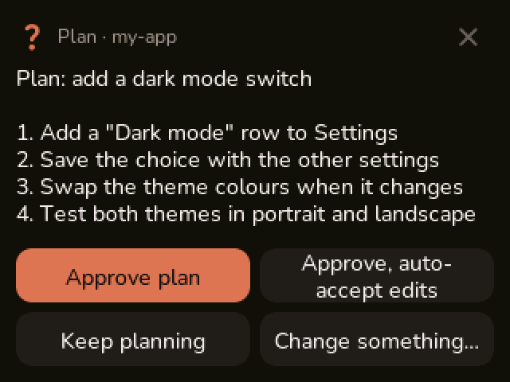
</p>

## 5. Projects, chats and quick commands

The **Chat** tab shows the open chat: your messages and Claude's replies. Tap the project name to pick
another **project** (your Claude Code folders), then a **chat** in it, or start a new one. Type with
the on-screen keyboard, or use the buttons:

- **Quick commands** (More → Commands): Continue, Run tests, Commit, /compact, Explain step, Stop,
  Type…, and one of your own (long-press "New command" to set it).
- The **Assistant**, always first in the projects list, is a chat for anything that isn't a project,
  such as "remind me what I did yesterday". When you leave it, it starts fresh next time. Long-press
  an old Assistant chat to delete it.

Messages you send from the board go to Claude Code on your PC (`claude -p --resume`), so the chat
continues where you left it.

<p>
  
  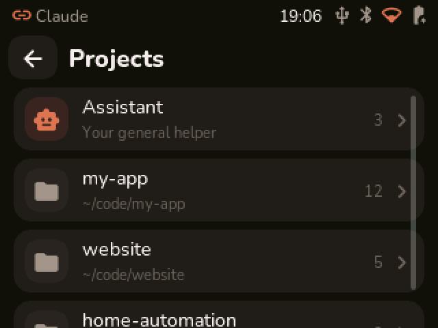
  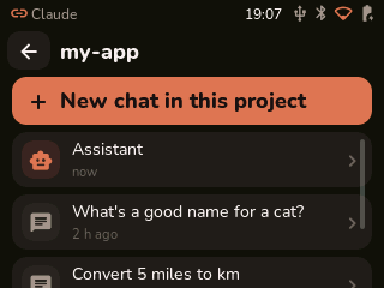
  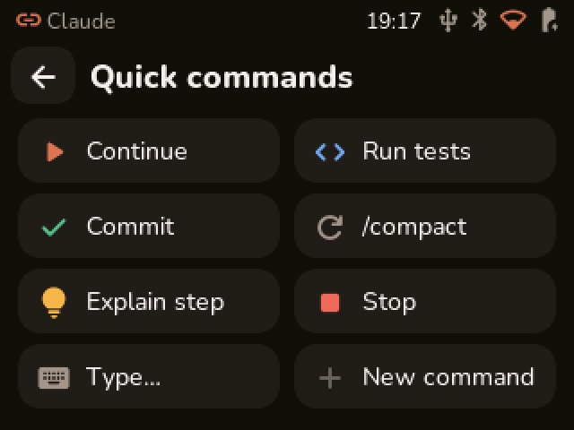
</p>

## 6. Talk to it

Tap the round orange **microphone** button in the middle of the dock and speak. When you stop talking,
the board sends your words to the open chat. With **Read replies aloud** on (Settings), it speaks
Claude's answer through its speaker.

The **Headset** screen (More → Headset) shows the link to your PC and the microphone level. It has a
hold-to-talk button and a mute button.

Speech works in English, German, French, Italian and Portuguese: set it in Settings → Speech language.
The screens come in the same languages (Settings → Language).

All of this runs on your PC: faster-whisper turns speech into text, and Piper speaks the replies.
Nothing is sent to a speech service.

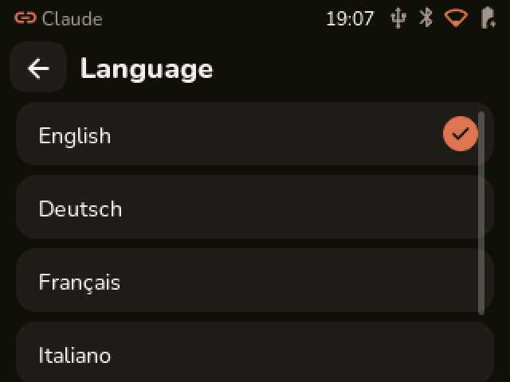

## 7. Your pet and your day

The **Buddy** tab is your pet's page: its mood, how fed and rested it is, its level, and how long it
napped. The time left in your Claude usage window shows there too, estimated from your local Claude
Code logs. The pet feeds on your Claude activity: the more Claude works, the more it eats and the
higher its level. Answering approvals quickly makes it happy, and denying a lot makes it sad. It gets
tired the longer it stays awake, and a nap while you're away restores its energy.

- **Characters** (More → Characters): DevelopKing, the pixel-art king in the pictures, or one of 18
  little ASCII pets.
- **Today** (More → Today) sums up your day: time worked, projects and chats, prompts, files changed,
  tools used, your streak, and optionally a short written recap made by Claude (Settings → Day recap
  by Claude). The clock icon at the top switches to yesterday.
- **Clock** (More → Clock) turns the board into a desk clock.

<p>
  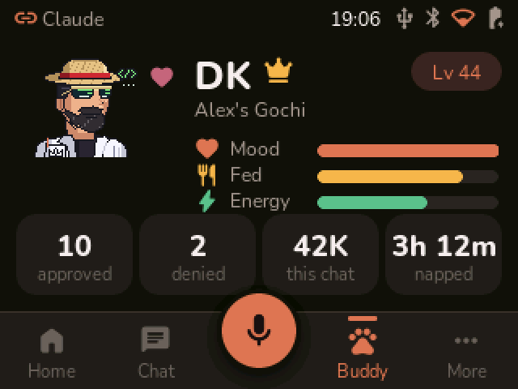
  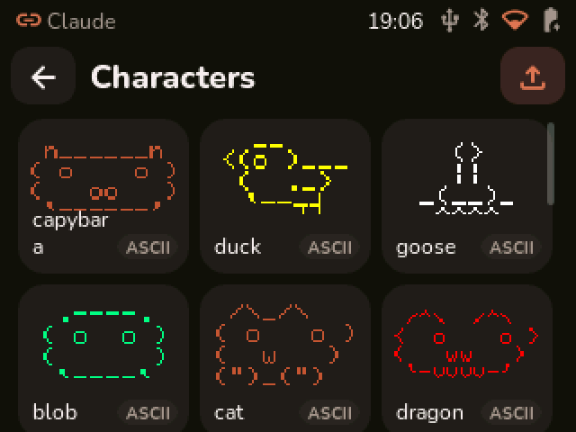
  
  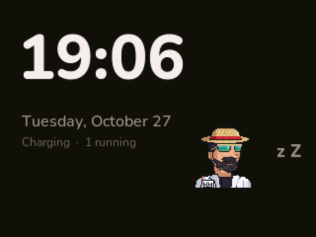
</p>

## 8. Portrait or landscape

Settings → Screen turns the whole interface: landscape, portrait, or either one upside down, to suit
your stand or case. Every screen has its own portrait layout.

<p>
  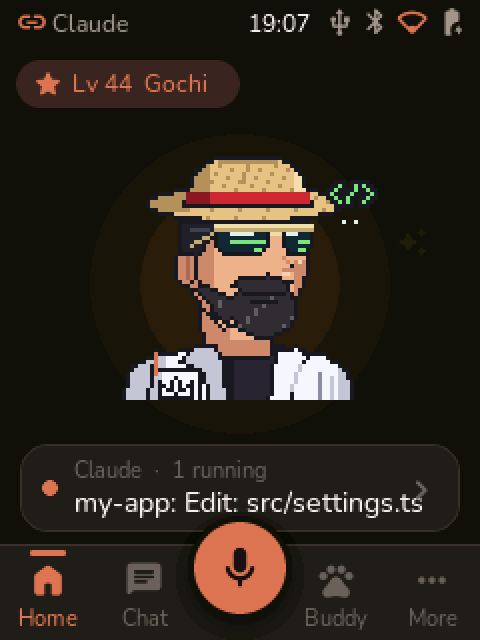
  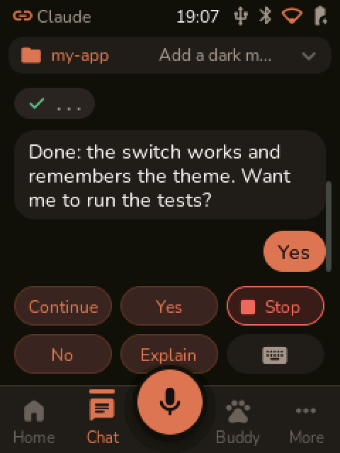
  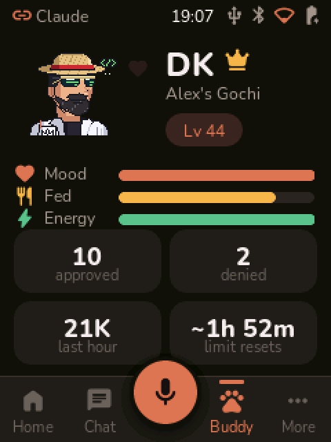
  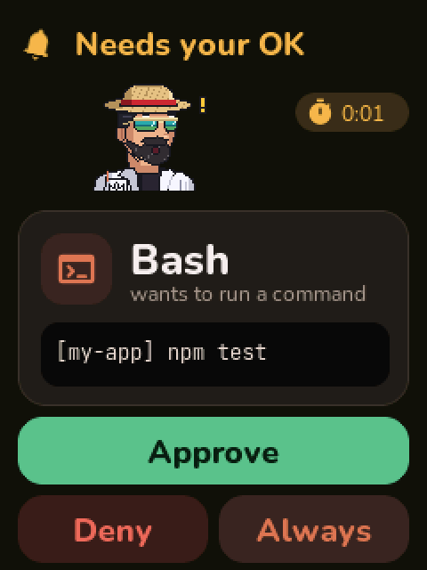
</p>

## 9. Optional: the Claude desktop app's Hardware Buddy

The Claude desktop app can talk to a "Hardware Buddy" over Bluetooth, and Vibe-a-Gochi speaks that
protocol too. Then the board also shows the desktop app's sessions and approvals.

1. In the Claude desktop app: Help → Troubleshooting → **Enable Developer Mode**.
2. Developer → **Open Hardware Buddy** → Connect, and pick **Claude-xxxx**.

This is optional: everything else works over WiFi without it.

## 10. Updates and changing it

**Updates over WiFi:** when you build a newer firmware on the PC, the companion offers it on the board
("Install" / "Later"). You can also run `pio run -t ota` in `firmware`, with no cable and no BOOT button.

**Changing the screens:** the files in `firmware/src/ui` and `firmware/src/ui_fonts` are generated;
don't edit them. Edit `ui/tools/gen_ui.py` (screens), `ui/tools/i18n.py` (texts in 5 languages) or
`ui/tools/prep_fonts.py` (icons), then run `python ui/tools/gen_ui.py --build`. That needs EEZ Studio
(free), Node.js and lv_font_conv; their paths are set at the top of `ui/tools/eez.py`.

**Your own character:** `characters/developking` has the scripts that draw DevelopKing and pack his
animations (idle, busy, attention, celebrate, sleep…). Draw your own pixel-art pet the same way, put it
in `firmware/data/characters` and upload it with `pio run -t uploadfs`.

**Ideas:** a 3D-printed case, a battery, more languages, more quick commands. Pull requests are welcome!

## What's in this repository

| Folder | |
|---|---|
| `firmware/` | the board's firmware (PlatformIO, Arduino core 3 for ESP32-S3, LVGL 9) |
| `firmware/data/` | files for the board's flash: the DevelopKing character |
| `companion/` | the PC side (Python): Claude Code hooks, the companion app, setup |
| `ui/` | the generator of the touch UI (`ui/tools/gen_ui.py` writes an EEZ Studio project) |
| `characters/developking/` | the DevelopKing pixel-art character and the scripts that draw it |
| `docs/companion.md` | how the board and the PC talk |

## Privacy

Everything runs on your PC and your board: the companion reads Claude Code's own logs in
`~/.claude/projects` to show your chats and the day summary, and speech is recognised and spoken
locally. Only the optional "Day recap by Claude" sends something more to Claude (through your own
Claude Code, model Haiku): the day's numbers, project names and the first 120 characters of up to 40 of
that day's prompts. Turn it off in Settings on the board. The pairing token in `~/.vibe-buddy/config.json`
lets your PC talk to the board: keep it to yourself.

## Credits and licenses

Vibe-a-Gochi is free software under the [MIT license](LICENSE). It stands on the shoulders of these
projects. Thank you!

- **[claude-desktop-buddy](https://github.com/anthropics/claude-desktop-buddy)** by Anthropic (MIT): the
  Hardware Buddy protocol, the 18 ASCII pets, and the parts of the firmware ported from it
- **LVGL** (MIT) for the graphics, **LovyanGFX** (BSD) for the display and touch, **ArduinoJson** (MIT),
  **NimBLE-Arduino** (Apache-2.0), **AnimatedGIF** (Apache-2.0), **AsyncTCP** and **ESPAsyncWebServer**
  (LGPL-3.0), the **Arduino core for ESP32** (LGPL-2.1) and **ESP-IDF** (Apache-2.0)
- **EEZ Studio** and the EEZ Flow runtime by Envox (generated code: MIT)
- The **Adafruit GFX** 5×7 font (BSD), and Espressif's ES8311 codec driver (Apache-2.0) for the audio start-up
- Fonts: **Nunito** and **JetBrains Mono** (SIL Open Font License), **Material Symbols** icons by Google (Apache-2.0)
- Speech: **faster-whisper** (MIT) with OpenAI's Whisper model (MIT), and **Piper** (GPL-3.0, installed
  by the setup, not included here)
- Voices for Piper, from [rhasspy/piper-voices](https://huggingface.co/rhasspy/piper-voices): English
  "Alba" and French "SIWIS" are based on speech data by the University of Edinburgh (CC BY 4.0);
  German "Thorsten" (Thorsten Müller), Italian "Paola" and Portuguese "Tugão" are CC0.

The full list with every license is in [THIRD_PARTY_NOTICES.md](THIRD_PARTY_NOTICES.md).

"Claude" and "Anthropic" are trademarks of Anthropic, PBC. Vibe-a-Gochi is an independent project, not
made, endorsed or supported by Anthropic. "Hosyond" is the board seller's brand; this project is not
affiliated with them.
